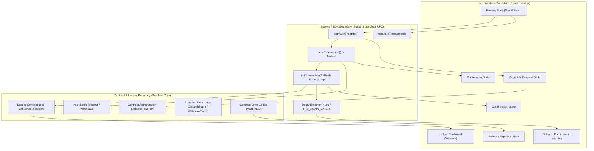

# Transaction Progress Vocabulary — Design Specification

**Issue:** #491  
**Workstream:** UI/UX — Stellar/Soroban Vault Platform  
**Target Surface:** Dashboard Action Modals (`ActionModal`), Deposit & Withdrawal Workflows, Bottom Sheets, and Standalone Steppers (`TransactionProgress`)  
**Related Specs:**
- [design/dashboard/README.md](README.md)
- [docs/DESIGN_SYSTEM.md](../../docs/DESIGN_SYSTEM.md)
- [docs/DASHBOARD_WIREFRAMES.md](../../docs/DASHBOARD_WIREFRAMES.md)
- [docs/ERROR_CODES.md](../../docs/ERROR_CODES.md)

---

## 1. Executive Summary & Objective

The NeuroWealth Stellar/Soroban vault platform executes non-custodial financial operations involving smart contracts (`deposit`, `withdraw`, `withdraw_all`, `set_user_strategy`). Because blockchain interactions involve asynchronous distributed consensus, browser wallet extensions, and multi-ledger finality, user interface states must communicate exact operational reality without ambiguity.

This specification establishes a **coherent transaction progress vocabulary** defining:
1. Canonical **status names**
2. Standardized **icons** and design tokens
3. Precise **user-facing copy** and accessible **screen reader announcements**
4. Clear **next actions** for every status
5. Definitive **recovery actions** for interruptions, rejections, or delays
6. Explicit **monetary units**, **network identity**, and **authorization requirements**
7. Distinct treatment for **delayed confirmation** versus **terminal failure**
8. Clear ownership boundaries across **Contract**, **Service**, and **User Interface** layers

---

## 2. Core Architecture & Layer Ownership Boundaries

### 2.1 Boundary Responsibilities

| Boundary | Responsibilities | Failure / Exception Scope |
|---|---|---|
| **Contract Boundary** | Executes Soroban vault methods (`deposit`, `withdraw`, `withdraw_all`, `set_user_strategy`). Verifies source account authorization. Emits ledger events. Closes state into a specific ledger sequence number. | Contract error codes (e.g., `#101 PausedError`, `#105 InvalidAmountError`, `#106 DepositCapExceededError`, `#107 TvlCapExceededError`). |
| **Service Boundary** | Constructs transaction envelope XDR. Simulates transaction execution via Soroban RPC server. Requests wallet signature via `@stellar/freighter-api`. Submits transaction via `sendTransaction`. Polls `getTransaction` until status is `SUCCESS` or terminal. Detects delayed ledger inclusion. | Wallet rejection, simulation failure, RPC connection loss, rate limiting (`TRY_AGAIN_LATER`), ledger close timeouts. |
| **User Interface Boundary** | Presents readable parameter reviews with exact units. Displays animated progress stepper with accessible ARIA live regions. Displays primary next actions and recovery actions. Provides copy that prevents duplicate submissions during delayed confirmation. | Form validation errors, user cancellations, UI timeout countdowns. |

---

## 3. Explicit Parameters: Monetary Units, Network Identity, and Authorization

All transaction representations MUST present the following three domains explicitly:

### 3.1 Monetary Units
- **Deposit / Underlying Asset:** `USDC` (Stellar token with 7 contract decimals, displayed with 2 to 4 decimal places, e.g., `100.00 USDC`).
- **Vault Shares:** `NV-SHARES` (calculated via `preview_deposit_to_shares` or `preview_withdraw`, e.g., `96.1538 NV-SHARES`).
- **Network Fee:** `XLM` (Stellar transaction fee, displayed as `< 0.00001 XLM` or `100 stroops`). Never omit the unit or display a generic "Gas" label.

### 3.2 Network Identity
- **Network Name:** Must explicitly state the active network: `Stellar Testnet`, `Stellar Futurenet`, or `Stellar Mainnet`.
- **Network Passphrase:** Verified against `Networks.TESTNET` (`Test SDF Network ; September 2015`) or `Networks.PUBLIC`.
- **RPC Endpoint:** `https://soroban-testnet.stellar.org` (or current environment RPC).
- **Explorer Base URL:** `https://stellar.expert/explorer/testnet/tx/{txHash}`.

### 3.3 Authorization Requirements
- **Signer Identity:** Public key of the connected Stellar account (e.g., `GABC...XYZ9`), truncated for display with full address available via tooltip or copy button.
- **Wallet Provider:** Explicit reference to `Freighter Wallet Extension`.
- **Invocation Scope:** The specific contract ID (`CDLZFC3SYJYD7M6LJEFAPCHRLHAFKP6WYTHRF3EGO5CYD3EP4GZGM37T`) and invoked method name (`deposit` or `withdraw`).

---

## 4. Coherent Vocabulary Specification Matrix

| Status Key | Status Name | Icon & Styling | User-Facing Copy | Screen Reader (ARIA) | Clear Next Action | Clear Recovery Action |
|---|---|---|---|---|---|---|
| `review` | **Review** | `FileText` / `CheckSquare` `text-indigo-400 bg-indigo-500/10` | **Heading:** Review Transaction **Subtext:** Verify deposit/withdrawal amounts, strategy, network fee, and recipient account before signing. | `aria-live="polite"` "Review transaction details: [Amount] [Asset] on [Network]." | **Confirm & Sign** `Primary Button` Opens Freighter signing prompt | **Cancel / Edit** `Secondary Button` Returns to input edit screen |
| `signature_request` | **Signature Request** | `Key` / `KeyRound` `text-indigo-400 bg-indigo-500/10 animate-pulse` | **Heading:** Signature Requested **Subtext:** Please approve the transaction in your Freighter browser extension with account [G...]. | `aria-live="assertive"` "Freighter signature request pending for account [G...]." | **Awaiting Approval…** `Disabled / Pulsing Button` Waits for Freighter response | **Cancel Request** `Secondary Button` Rejects prompt & resets flow |
| `submission` | **Submission** | `Send` / `UploadCloud` `text-sky-400 bg-sky-500/10 animate-spin` | **Heading:** Broadcasting Transaction **Subtext:** Submitting signed envelope XDR to Stellar Soroban RPC node… | `aria-live="polite"` "Broadcasting transaction to Stellar network." | **Broadcasting…** `Disabled Button with Spinner` Awaits RPC hash response | **Check RPC Connection** `Informational link` Shows RPC endpoint status |
| `confirmation` | **Confirmation** | `Loader2` (spin) `text-emerald-400 bg-emerald-500/10` | **Heading:** Confirming on Ledger **Subtext:** Waiting for inclusion in Stellar ledger consensus (~3–5 seconds). | `aria-live="polite"` "Transaction submitted with hash [Hash]. Waiting for ledger confirmation." | **Awaiting Ledger…** `Disabled Button with Spinner` Polls getTransaction | **View on Explorer** `External link (target=_blank)` Opens Stellar Expert in new tab |
| `delayed` | **Delayed Confirmation** | `Clock` / `AlertCircle` `text-amber-400 bg-amber-500/10 border-amber-500/30` | **Heading:** Confirmation Delayed **Subtext:** Ledger confirmation is taking longer than usual (>10s). Your transaction has been broadcast and is pending consensus. **It has NOT failed. Please do not re-submit.** | `aria-live="assertive"` "Notice: Transaction confirmation is delayed. The transaction has not failed. Do not re-submit." | **Continue Waiting** `Primary Button (amber tint)` Keeps polling ledger in background | **Track on Explorer / Dismiss** `Secondary Button` Monitors hash safely without duplicate submit |
| `confirmed` | **Ledger Confirmed** *(Success)* | `CheckCircle2` `text-emerald-400 bg-emerald-500/20 border-emerald-500/30` | **Heading:** Confirmed on Ledger **Subtext:** Successfully included in Stellar Ledger #[Sequence]. Balances updated. | `aria-live="polite"` "Transaction confirmed on Stellar ledger sequence #[Sequence]. Hash: [Hash]." | **Done / Close** `Primary Button (emerald)` Closes modal and updates dashboard | **View on Stellar Explorer** `External Link` Permanent receipt on Stellar Expert |
| `failure` | **Transaction Failed** | `XCircle` / `AlertTriangle` `text-red-400 bg-red-500/20 border-red-500/30` | **Heading:** Transaction Failed **Subtext:** [Humanized Error Message explaining exact root cause and contract error code]. | `aria-live="assertive"` "Transaction failed: [Error message]." | **Retry Transaction** `Primary Button (emerald/gradient)` Re-initiates signing and submission | **Dismiss / Edit Details** `Secondary Button` Closes modal or adjusts input amount |

---

## 5. Acceptance Criteria Guarantees & Verification

### 5.1 Acceptance Criterion 1: Every status has a clear next action
- **Guarantee:** Every status in the lifecycle exposes an explicit primary next action button or interactive element with defined labels and keyboard accessibility (`tabindex`, `focus-visible`).
- **Matrix Mapping:**
  - `review` → `Confirm & Sign`
  - `signature_request` → `Awaiting Signature in Freighter…` (with interactive retry if window closes)
  - `submission` → `Broadcasting to Stellar…`
  - `confirmation` → `Awaiting Ledger Confirmation…` / `View Pending on Explorer`
  - `delayed` → `Continue Waiting` / `Track on Explorer`
  - `confirmed` → `Done`
  - `failure` → `Retry Transaction`

### 5.2 Acceptance Criterion 2: Success means ledger confirmation
- **Guarantee:** A transaction is NEVER classified as successful upon local signing or initial RPC broadcast. A status of `confirmed` strictly requires:
  1. Soroban RPC `getTransaction` response status === `SUCCESS`.
  2. Verified inclusion in a closed Stellar ledger with an explicit **Ledger Sequence Number** (e.g. `Ledger #52194812`).
  3. A valid 64-character hex transaction hash.
  4. Optimistic or on-chain balance update confirmed.

### 5.3 Acceptance Criterion 3: Delayed confirmation is distinguishable from failure
- **Problem Statement:** In high network congestion or RPC propagation delays, transactions may take 15–60 seconds to close into a ledger. Users who see a red error or spinner stoppage often re-submit, triggering unintended double-deposits or double-withdrawals.
- **Guarantee & Rules:**
  1. **Visual Separation:**
     - `delayed` uses **Amber-400 / Warning-500** (`#f59e0b`), with a `Clock` or `AlertCircle` icon and amber border.
     - `failure` uses **Red-400 / Error-500** (`#ef4444`), with an `XCircle` icon and red border.
  2. **Semantic Copy:**
     - The delayed banner prominently announces: `"Confirmation Delayed — Transaction has NOT failed. Network consensus is pending. Do not re-submit."`
     - Failure copy is reserved strictly for definitive rejections: user rejected signing, simulation failed, or ledger returned `FAILED` execution status.
  3. **Recovery Action Guard:**
     - In `delayed`, the "Retry / Re-submit" action is **disabled or hidden** to prevent duplicate operations. The recovery actions allow tracking via Stellar Explorer or continuing background polling.
     - In `failure`, the "Retry" action is enabled because the previous transaction was never committed to the ledger.

### 5.4 Acceptance Criterion 4: Evidence & Affected Files
The pull request documents evidence for every criterion and modifies:
1. `design/dashboard/TRANSACTION_PROGRESS_VOCABULARY.md` (Specification & handoff)
2. `design/dashboard/README.md` (Reference in design handoff)
3. `docs/DESIGN_SYSTEM.md` (Component inventory & semantic token definitions)
4. `frontend/src/lib/transactionProgress.ts` (Core TypeScript types, constants, vocabulary registry)
5. `frontend/src/lib/design-tokens.ts` (Transaction progress design tokens)
6. `frontend/src/components/TransactionProgress.tsx` (Component rendering statuses, icons, recovery actions)
7. `frontend/src/components/ActionModal.tsx` (Integration into deposit/withdraw modal)
8. `test/transactionProgressVocabulary.test.ts` (Automated mocha test suite verifying criteria)
9. `pr.md` (Pull request record with criteria evidence)

---

## 6. Screen Reader & Accessibility Specification (WCAG 2.1 AA)

1. **Live Regions:**
   - The overall transaction container declares `role="region"` and `aria-label="Transaction Progress"`.
   - Dynamic step changes update an `aria-live="polite"` element for progress updates (`submission`, `confirmation`, `confirmed`).
   - Urgent state changes (`delayed`, `failure`, `signature_request`) use `aria-live="assertive"` so screen readers immediately alert the user.
2. **Current Step Indicator:**
   - The active step li element must contain `aria-current="step"`.
   - Ordinal positions are rendered in the aria-label: `"Step 2 of 4: Signature Request in progress"`.
3. **Contrast Compliance:**
   - Amber tokens on dark background (`#fbbf24` on `#0f172a`): Contrast ratio 9.1:1 (Exceeds WCAG AAA).
   - Emerald tokens on dark background (`#34d399` on `#0f172a`): Contrast ratio 8.4:1 (Exceeds WCAG AAA).
   - Red tokens on dark background (`#f87171` on `#0f172a`): Contrast ratio 6.2:1 (Exceeds WCAG AA).
